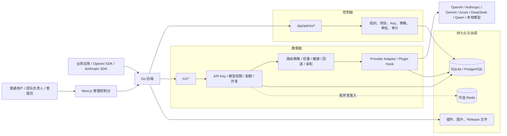
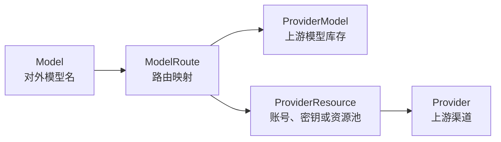
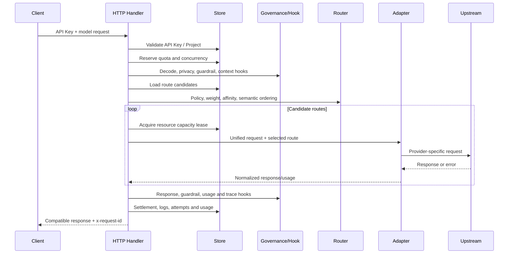
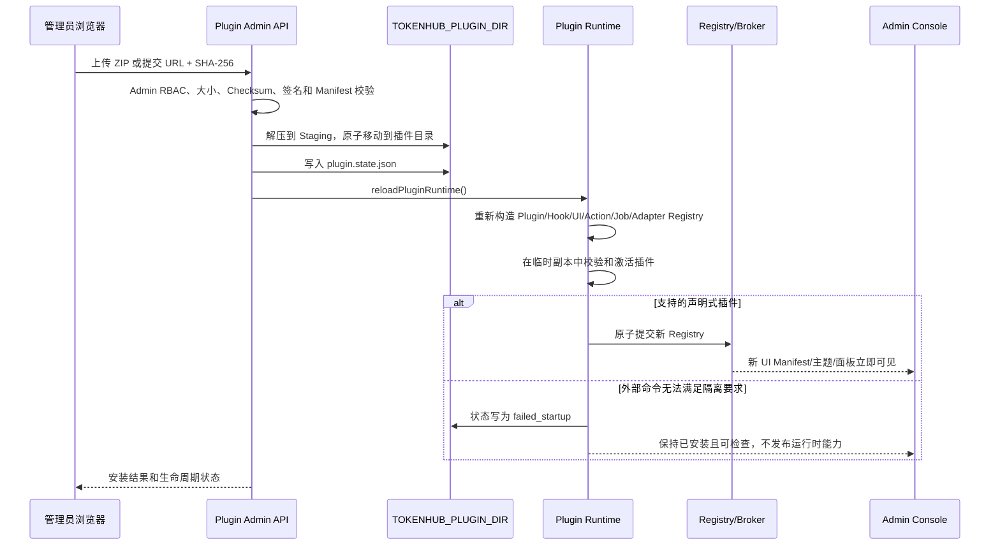
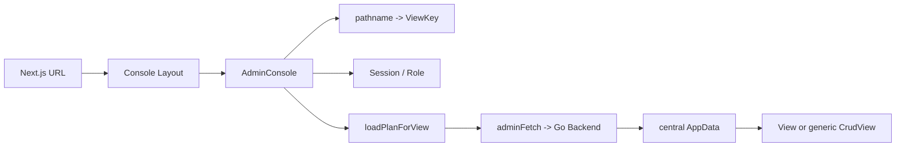

# TokenHub 项目全景导读

> 这是一份面向新开发者的代码库导览。目标不是替代现有的产品、部署和 API 文档，而是建立一套能够指导阅读源码、定位功能、修改代码和验证变更的整体认知。

## 1. 项目定位

TokenHub 是一个面向企业内部的 AI Gateway 与 Token Governance 平台。它位于业务应用和上游模型服务之间，将分散的模型调用统一纳入认证、授权、路由、配额、计量、成本归因、审计和运维体系。

它同时解决三类问题：

1. **统一接入**：向业务应用提供 OpenAI-compatible、Anthropic Messages、Embeddings、Rerank、图片和媒体等 API。
2. **模型治理**：统一管理 Provider、Provider Resource、上游模型库存、对外模型、路由、权限、配额和安全策略。
3. **企业运营**：记录请求和用量，处理成本归因、Provider 账单同步与对账、告警、审批、审计和备份。

从代码结构看，TokenHub 不是一个简单的反向代理，而是由以下部分组成的完整平台：

- Go 后端：数据面、控制面、持久化、后台任务和运维接口。
- Next.js 管理控制台：管理员、团队负责人、安全人员和普通用户的角色化工作台。
- SQLite/PostgreSQL 数据层：配置、身份、调用日志、计量、任务、审计和集群协调。
- Provider 与插件体系：上游协议适配、模型目录、请求链 Hook、管理动作和声明式 UI。
- SDK smoke tests：验证兼容 API 能否被常见 SDK 正常调用。
- Docker Compose、原生 systemd 和 Helm：覆盖本地、单机生产和多实例部署。

## 2. 一张图理解系统



最重要的心智模型是：

- **控制面**负责“配置系统应该怎么工作”。
- **数据面**负责“每一次模型请求实际怎么执行”。
- **运维面**负责“系统是否健康、如何升级、如何追踪和恢复”。
- 三者当前主要位于同一个 Go 进程中，共享 Store 和数据库。

## 3. 仓库目录地图

```text
TokenHub/
├── backend/                 Go 后端、数据库、Provider、插件和测试
│   ├── cmd/                 可执行程序入口
│   ├── internal/server/     HTTP、路由、Store、Provider、后台任务等主应用包
│   ├── internal/billing/    外部账单连接器与同步服务
│   ├── internal/dbschema/   数据库演进引擎
│   ├── internal/guardrails/ 内容安全策略与检测器
│   ├── internal/metering/   计量和价格计算
│   ├── internal/migration/  外部系统配置迁移
│   ├── internal/plugin/     插件 Manifest、注册表、运行时和 Hook
│   └── internal/reconciliation/ 对账规则与服务
├── frontend/                Next.js 管理控制台
│   ├── app/                 App Router 路由壳
│   ├── features/admin/      实际管理控制台业务代码
│   ├── e2e/                 完整前后端浏览器测试
│   └── tests/ui/            无数据库 UI acceptance fixtures
├── sdk/                     OpenAI/Anthropic/安全策略等烟测
├── plugin-devkit/           外部插件协议 SDK、样例和契约测试
├── data/                    模型目录、Provider 目录和内置插件
├── deploy/                  Compose、systemd、Helm 和安装脚本
├── docs/                    产品、架构、部署、API 和开发文档
├── tools/                   仓库级契约检查工具
├── benchmarks/              性能预算和对比脚本
├── start.sh                 本地开发一键启动
└── AGENTS.md                开发规范和验证要求
```

### 3.1 阅读优先级

第一次阅读不建议按目录顺序逐文件查看。推荐使用下面的路径：

1. `README.zh-CN.md`：产品定位和角色。
2. `docs/zh-CN/architecture.md`：部署形态、请求链和数据边界。
3. `backend/cmd/tokenhub/main.go`：后端启动过程。
4. `backend/internal/server/http.go`：后端组合根。
5. `backend/internal/server/routes.go`：完整 HTTP Surface。
6. `backend/internal/server/gateway_http.go`：典型网关请求链。
7. `frontend/features/admin/shell/admin-console.tsx`：前端总编排器。
8. `frontend/features/admin/core/navigation.tsx`：角色和页面地图。
9. `deploy/docker-compose.yml` 与 `docs/zh-CN/deployment.md`：运行方式。
10. 与当前任务对应的测试文件：测试通常是最精确的行为契约。

## 4. 核心领域模型

理解以下实体之间的关系，是理解整个项目的关键。

### 4.1 租户、用户与调用凭证

| 实体 | 含义 | 主要用途 |
| --- | --- | --- |
| `AdminUser` | 可登录控制台的用户 | 管理员、安全人员、团队负责人和普通用户 |
| `AdminSession` | 控制台登录会话 | 访问 `/api/admin/*` |
| `Team` | 组织或团队分组 | 成员管理和成本归属 |
| `Project` | 业务项目空间 | API Key、额度、成员、模型权限和成本归属 |
| `APIKey` | 业务调用凭证 | 访问 `/v1/*`；数据库只保存摘要和展示前后缀 |

管理会话和业务 API Key 是两套不同的认证体系：

- 管理控制台使用管理员登录会话，或可选的静态 Admin Token。
- 业务应用使用 Project API Key。

### 4.2 Provider、资源、模型和路由



| 实体 | 解释 |
| --- | --- |
| `Provider` | 一个上游渠道，例如 OpenAI、Azure OpenAI、Anthropic 或某个兼容服务。 |
| `ProviderResource` | Provider 下的实际可调用资源，如 API Key、账号、订阅或区域资源。 |
| `ProviderModel` | 某个 Provider 下发现或导入的上游模型库存。 |
| `Model` | TokenHub 对调用方公开的统一模型名和能力合同。 |
| `ModelRoute` | 将公开 `Model` 映射到 Provider、Resource 和 ProviderModel。 |

这个设计支持：

- 同一个公开模型映射到多个 Provider，实现故障转移和成本优化。
- 使用自定义别名，业务方不需要知道真实上游模型名。
- 对路由应用权重、优先级、健康状态、作用域策略和会话亲和。
- 将“可被上游调用的库存”和“可被租户使用的产品模型”分开管理。

### 4.3 治理、计量和审计

| 类别 | 代表实体 |
| --- | --- |
| 配额与并发 | `QuotaBucket`、`InFlightLease`、Quota Policy |
| 用量与成本 | `UsageRecord`、Rate Card、Pricing Period |
| 请求追踪 | `RequestLog`、`RequestPayloadLog`、`RouteAttemptLog` |
| Provider 观测 | `ProviderObservation`、`ProviderResourceObservation` |
| 管理审计 | `AuditEvent` |
| 账单同步 | `BillingConnector`、`BillingRecord`、`BillingSyncRun` |
| 对账 | Reconciliation Rule、Reconciliation Run |
| 集群协调 | `ClusterLease`、`ClusterTaskState`、实例 Heartbeat |
| 后台响应 | `ResponseJob`、`ResponseJobEvent` |
| 图片任务 | `ImageJob`、`ImageAsset` |

## 5. 后端架构

## 5.1 进程入口和启动顺序

后端入口是 `backend/cmd/tokenhub/main.go`。

启动顺序大致如下：

1. 加载 `.env`，但不覆盖已经存在的系统环境变量。
2. 解析 `TOKENHUB_*` 配置。
3. 执行 `PrepareForStartup()` 和 `ValidateForStartup()`。
4. 配置不安全时只启动 configuration-required 模式，不开放正常业务能力。
5. 执行托管升级的 startup guard。
6. 打开 SQLite 或 PostgreSQL Store。
7. 执行数据库 adoption、migration、backfill 和启动 bootstrap。
8. 构造 `Server` 组合根。
9. 启动账单、对账、凭证刷新、保留策略和其他后台任务。
10. 刷新 Provider Catalog 数据库快照。
11. 启动 `net/http` 服务。
12. 收到 SIGINT/SIGTERM 后优雅停止 HTTP、worker、scheduler、heartbeat 和 tracing。

后端还提供以下命令入口：

- `tokenhub db ...`：数据库检查和维护。
- `tokenhub initial-admin-password`：读取一次性初始管理员密码。
- `cmd/tokenhub-migrate`：从其他系统迁移配置。
- `cmd/manifestgen`：生成数据库迁移 Manifest。
- `cmd/pluginmanifestgen`：生成插件相关 Manifest。
- `cmd/marketplace-validate`：验证插件市场数据。
- `cmd/tokenhub-benchmark`：运行性能基准。

## 5.2 `Server` 是后端组合根

`backend/internal/server/http.go` 中的 `Server` 聚合了主要运行时依赖：

- `Store`
- HTTP mux
- Adapter Registry
- Plugin Registry 与 Gateway Hook Runner
- Billing 与 Reconciliation Service
- Guardrail Engine
- Provider Catalog Service
- 上游 HTTP Client 和 SSRF/Proxy 策略
- Metrics 与 Trace Emitter
- Responses Worker
- Image Worker
- Provider Credential Refresh
- Payload Retention
- Version/Upgrade Service

`newWithConfig()` 是最重要的依赖装配函数。阅读某项能力“在哪里被接入系统”时，应优先从这里向下追踪。

## 5.3 后端包边界

### `internal/server`

这是当前最大的应用包，包含：

- HTTP 路由和 Handler
- Gateway 请求生命周期
- Provider Adapter 和协议桥
- GORM Store 实现
- Admin RBAC
- 配额、计量和结算
- Responses/Image Worker
- Metrics、Tracing 和健康检查

多数功能最终都需要在这里接线。它也是变更风险最高的区域。

### `internal/billing`

负责外部 Provider 账单同步：

- Connector 配置
- 分页拉取和重试
- 账单记录标准化
- 同步 Checkpoint
- 定时调度

它与实时请求计量不同：实时计量记录 TokenHub 内部实际请求，Billing Service 拉取 Provider 侧账单，两者随后进入对账流程。

### `internal/reconciliation`

负责将内部用量与外部账单进行比较，应用规则并生成差异结果。

### `internal/dbschema`

负责数据库演进：

- Frozen baseline
- Migration ledger 和 checksum
- Expand/Contract migration
- Data backfill ledger
- SQLite/PostgreSQL 方言
- 集群迁移锁
- 实例 heartbeat 和兼容性检查

### `internal/plugin`

负责：

- `plugin.yaml` Manifest 解析和验证
- 权限描述
- Plugin Registry
- Gateway Chain
- Admin Action
- Background Job
- Admin UI Manifest
- 包安装、启用、更新和回滚状态

### `internal/guardrails`

负责内容安全策略和检测器。可通过配置接入 Qwen3Guard 兼容服务。

### `internal/metering`

负责原生计量单位、价格和成本计算。

### `internal/migration`

这是“外部系统配置导入”，不要与数据库 schema migration 混淆。

## 6. HTTP API 地图

后端路由集中在 `backend/internal/server/routes.go`。

### 6.1 健康、文档和观测

| 路径 | 作用 |
| --- | --- |
| `GET /livez` | 仅表示进程存活 |
| `GET /readyz` | 检查数据库和演进状态是否可服务 |
| `GET /healthz` | 与 readiness 兼容的健康检查 |
| `GET /metrics` | Prometheus 指标，需配置启用 |
| `GET /docs` | Swagger UI |
| `GET /openapi.json` | OpenAPI 3.1 JSON |
| `GET /openapi.yaml` | OpenAPI 3.1 YAML |

### 6.2 公共模型 API

| API | 说明 |
| --- | --- |
| `GET /v1/models` | 列出调用方有权限访问的模型 |
| `POST /v1/chat/completions` | OpenAI Chat Completions，支持流式 |
| `POST /v1/responses` | OpenAI Responses，同步、流式或后台执行 |
| `GET /v1/responses/{id}` | 查询后台 Responses Job |
| `POST /v1/responses/{id}/cancel` | 取消后台 Job |
| `POST /v1/responses/compact` | Compact 能力 |
| `POST /v1/messages` | Anthropic Messages |
| `POST /v1/messages/count_tokens` | Anthropic Token 计数 |
| `POST /v1/embeddings` | 文本向量 |
| `POST /v1/rerank` | 文档重排 |
| `POST /v1/images/generations` | 图片生成 |
| `POST /v1/images/edits` | 图片编辑 |
| `/v1/audio/*` | Speech、Transcription、Translation |
| `POST /v1/systemone` | TokenHub 专有结构化接口 |

### 6.3 管理 API

`/api/admin/*` 大致按以下领域划分：

- 认证：登录、退出、当前用户、密码重置、OAuth/OIDC。
- 组织：用户、团队、项目、项目成员。
- 凭证：API Key 创建、轮换、撤销和用量。
- Provider：Catalog、Provider、Resource、ProviderModel、OAuth 和探测。
- 模型路由：Model、Route、Routing Policy、模拟和解释。
- 插件：安装、权限差异、启停、升级、回滚、动作和后台任务。
- 治理：配额、成本中心、安全策略、审批和公告。
- 计量：Usage、Billing、Reconciliation、Rate Card。
- 运维：审计、告警、通知、SQLite Backup、数据库状态和版本管理。

新增 API 时通常需要同时更新：

1. `routes.go` 或对应二级 route registrar。
2. Handler。
3. Admin 或 API Key 鉴权。
4. OpenAPI 描述。
5. method-routing contract test。
6. 对象级授权测试。
7. 前端类型、payload mapper 和数据加载计划（如果 UI 使用）。

## 7. 一次模型请求如何执行

下面以 `/v1/chat/completions` 为例。



### 7.1 认证和准入

网关支持以下 API Key Header：

- `Authorization: Bearer ...`
- `x-api-key`
- Gemini SDK 兼容的 `x-goog-api-key`

Store 会检查：

- Key 摘要
- Key 状态和有效期
- Project 状态
- 调用方 IP/CIDR
- Project 与 Key 的模型权限交集
- RPM/TPM、预算和并发

准入成功后会生成 request ID，并预留 Token/并发容量。

### 7.2 Gateway Hook 和 Guardrail

请求链可在多个阶段插入能力：

- Auth context
- Decode/normalize
- Admission
- Privacy
- Request guardrail
- Context optimization
- Cache lookup/write
- Candidate selection/ranking
- Request transform
- Provider call
- Response transform
- Response guardrail
- Usage attribution
- Trace export

Hook 必须声明阶段、作用域、读写字段、优先级和失败策略。核心系统会校验 Hook 输出，不允许插件任意修改未授权数据。

### 7.3 路由候选和排序

候选路由需要同时满足：

- Model 与 Route 已启用。
- Provider 和 Resource 已启用且健康。
- ProviderModel 存在。
- 当前协议能力可用。
- Project/API Key 有模型访问权限。
- 作用域 Routing Policy 允许该 Provider、Resource、Model、标签、区域和环境。
- 对 Embeddings/Rerank 等接口，模型模态和价格合同匹配。

候选随后根据以下因素排序：

- 显式优先级
- Resource 优先级
- 权重
- 健康与冷却状态
- 会话亲和
- 语义路由结果
- 插件 route-ranking Hook

### 7.4 故障转移

非流式请求可按候选顺序尝试多个路由。

流式请求一旦向客户端输出内容，就不能安全切换到另一条上游流，因此流式故障转移只发生在响应尚未提交前。

Provider Resource 使用带冷却期的失败恢复机制：

- 连续失败达到阈值后进入冷却。
- 冷却结束后允许一个半开探测请求。
- 探测成功才恢复健康。
- 再次失败会延长冷却，直到配置上限。

### 7.5 结算和记录

请求结束后系统会处理：

- Token reservation 与实际 Usage 的结算
- Project/API Key/User 配额
- `UsageRecord`
- `RequestLog`
- `RouteAttemptLog`
- Provider observation
- Metrics 和 tracing
- 可选请求/响应 payload 审计
- Admin audit 或告警事件

## 8. Provider 与协议适配

### 8.1 Adapter Registry

`backend/internal/server/adapter_registry.go` 描述每种 Adapter 支持的能力，例如：

- Chat / Chat Stream
- Responses / Responses Stream
- Embeddings
- Rerank
- Media / Images
- Model Discovery
- Probe
- Quota
- OAuth
- Session Affinity

请求执行前会按能力过滤路由，而不是假设所有 Provider 都支持所有接口。

### 8.2 内置 Provider

主要内置类型包括：

- `openai`
- `openai_compatible`
- `azure_openai`
- `anthropic`
- `gemini`
- `deepseek`
- `qwen`
- `local`
- `openai_codex`
- `mock`

部分 Provider 使用原生协议，部分复用 OpenAI-compatible host adapter。

### 8.3 Catalog 的三层结构

| 文件/结构 | 作用 |
| --- | --- |
| `data/model-catalog.yaml` | TokenHub 统一公开模型的候选元数据 |
| `data/provider-catalog.json` | Provider 模板和目录 |
| `data/builtin-plugins/**/plugin.yaml` | Provider/平台能力的插件化声明 |

Catalog 是候选和模板，不等于运行时已经启用的 Provider、Model 或 Route。真正可调用能力仍由数据库配置、插件状态、凭证和路由决定。

### 8.4 上游网络安全

Provider 请求不能绕过统一 HTTP Client，因为其中包含：

- SSRF 地址检查
- Redirect 校验
- 私网/CIDR 策略
- Loopback 策略
- NAT64 处理
- Forward Proxy 选择
- Synthetic DNS 和 Transport Pool
- 非流式总超时与流式空闲超时

新增 Provider 时应复用这些受保护的传输层，而不是自行创建不受策略控制的 Client。

## 9. 插件体系

插件文档入口是 `docs/plugin-development/README.md`，开发工具位于 `plugin-devkit/`。

### 9.1 插件可以声明什么

- Provider Integration
- Gateway Hook
- Admin Action
- Background Job
- 声明式管理页面、设置面板、主题和布局
- Provider Catalog 和模型元数据

### 9.2 Plugin Runtime

`backend/internal/server/plugin_bootstrap.go` 在启动时组装：

- Plugin Registry
- Gateway Chain Registry
- Gateway Hook Runner
- Admin UI Registry
- Action Broker
- Background Job Broker/Runner
- Adapter Registry

插件生命周期变更通过运行时读写锁隔离，避免请求看到半更新状态。

### 9.3 当前外部执行边界

当前版本不会执行外部插件包中的命令型后端入口。

- Plugin Devkit 和样例定义了未来 `stdio-json-v1` 合同。
- 安装带外部命令的包后，系统会保留包供检查，但标记为 `failed_startup` 并失败关闭。
- 纯声明式 UI 包可以激活。
- 进程内置插件可以执行。

因此，不要把 Devkit 中可通过本地 contract test 的命令插件，误认为当前生产运行时会直接启动它。

### 9.4 “安装本地插件”到底可以安装什么

管理后台的“手动安装”支持两种来源：

1. **URL 安装**：提供 HTTPS ZIP 地址和必填的小写 SHA-256 校验和。
2. **上传 ZIP**：直接上传本地 ZIP；校验和可选，但正式分发仍建议提供并自行核对。

从 Manifest 角度，Plugin API v2 接受四个主分类：

| 分类 | 典型用途 | 当前外部包实际生效情况 |
| --- | --- | --- |
| `ui_template` | 主题 Token、Shell 布局、页面模板、Dashboard 组合、声明式 Admin UI | **可以生效**，前提是不包含外部后端命令，并且目标前端 Renderer 支持对应声明 |
| `provider_integration` | Provider 类型、资源、模型发现、调用协议 | 包可以安装和检查；外部命令型 Provider 当前会失败关闭，不能实际调用上游 |
| `request_pipeline` | Privacy、Guardrail、Route、Request/Response 等 Gateway Hook | 包可以安装和检查；外部命令型 Hook 当前不会执行 |
| `automation` | Admin Action、定时任务、后台同步或清理 | 包可以安装和检查；外部命令型 Action/Job 当前不会执行 |

因此，当前版本最适合真正通过“上传 ZIP”投入使用的是：

- 纯声明式 SIM/UI Template。
- 纯声明式 Admin UI 面板、Tab、卡片、字段和布局贡献。
- 不包含 `entry.backend.command` 的展示型插件包。

以下包虽然可以被安装、验证和展示详情，但目前不能作为外部可执行能力投入运行：

- 带二进制命令的 Provider 插件。
- 带命令的 Gateway Hook。
- 带命令的 Background Job。
- 带命令的 Admin Action。
- `plugin-devkit/examples/` 下的 `provider-*-go`、`hook-trace-go`、`background-heartbeat-go`、`action-echo-go` 等示例。

这些示例用于 Devkit 契约测试，而不是当前运行时可执行插件。它们启用后会进入 `failed_startup`，包仍保留在插件目录中供检查，但不会注册 Provider、Hook、Job 或 Action。

内置插件是例外。`data/builtin-plugins/` 中的 Provider、Action 和 Job 由 TokenHub Core 在进程内注册，不需要启动外部命令，因此可以正常工作。管理后台对未启用内置插件显示的“安装”，本质上是写入其启用状态并重新装配运行时，而不是上传一个新 ZIP。

### 9.5 ZIP 包需要满足的条件

安装器会先将 ZIP 写入临时 Staging 目录，再执行完整校验。主要约束包括：

- 压缩包不超过 64 MiB。
- 解压后总大小不超过 256 MiB。
- 文件数不超过 4096。
- 包中必须且只能发现一个 `plugin.yaml`。
- `plugin.yaml` 可以位于 ZIP 根目录，或唯一的一层顶级目录中。
- 不允许 Symbolic Link、绝对路径或 `../` 路径逃逸。
- Plugin ID 必须合法且全局唯一。
- Manifest Schema、Plugin API 和 TokenHub Core 版本必须兼容。
- 依赖插件及其版本约束必须满足。
- 包内引用的 Schema、资源和命令路径不能逃离插件目录。
- URL 安装必须通过 HTTPS，并提供匹配的 SHA-256。
- 配置了签名信任策略时，还必须通过 Ed25519 签名和信任源校验。
- 默认不允许覆盖同 ID 插件；只有勾选“允许替换”才会进入受控替换流程。

上传 ZIP 时可以选择：

- **允许替换**：替换已经安装的同 ID 插件；更新流程可保留回滚版本。
- **安装后启用**：安装完成后立即尝试激活；不勾选时以 `disabled` 状态保存。
- **预览权限**：URL 安装可在正式安装前查看新包相对于当前版本的权限变化。

### 9.6 一个当前可以生效的本地 UI 插件示例

最小的声明式主题插件可以只有一个 `plugin.yaml`，不包含可执行文件：

```yaml
schema_version: 2
id: example.sim.operations
name: Operations UI Template
version: 1.0.0
summary: Apply an operations-oriented console theme.
category: ui_template
tokenhub:
  plugin_api: v2
  min_core: 0.7.0
kinds: [sim]
placement: [presentation]
permissions:
  network:
    allow: []
  data:
    read: []
    write: []
capabilities:
  sim:
    theme_tokens:
      - id: operations-light
        mode: light
        default: true
        tokens:
          bg: "#f5f7fa"
          surface: "#ffffff"
          ink: "#172033"
          accent: "#1677ff"
          border: "#d9d9d9"
    shell_layouts:
      - id: operations-shell
        navigation: sidebar
        density: compact
        content_width: fluid
        default: true
```

打包：

```bash
mkdir -p example.sim.operations
cp plugin.yaml example.sim.operations/plugin.yaml
zip -r example.sim.operations_1.0.0_any.zip example.sim.operations
shasum -a 256 example.sim.operations_1.0.0_any.zip
```

随后可在“插件管理 → 浏览插件 → 手动安装 → 上传 ZIP”中选择文件，并勾选“安装后启用”。

这类插件生效后，前端通过 `/api/admin/plugin-ui-manifest` 获取声明式贡献，再由允许的 Renderer 应用主题和布局。它不能注入任意 JavaScript、CSS、远程脚本、Stylesheet URL、`@import` 或 `url(...)`。可编辑主题覆盖保存在当前浏览器，不是组织级服务端配置。

如果使用 `entry.frontend.schema` 提供 Admin UI JSON Schema，还可以向允许的 Slot 添加声明式内容，例如：

- `nav.section`
- `dashboard.card`
- `provider.form.section`
- `provider.resource.panel`
- `route.detail.panel`
- `settings.panel`
- `report.template`
- `theme.tokens`
- `layout.preset`
- `page.template`
- `dashboard.composition`

Schema 校验通过不代表每个 Slot 都支持所有 Control；仍需要针对实际 Renderer 做 UI 集成测试。

### 9.7 安装后是怎么生效的

本地插件从安装到生效的流程如下：



具体步骤：

1. `/api/admin/plugins/install` 先执行平台管理员权限检查。
2. URL 模式通过受保护的下载客户端取得 ZIP；上传模式读取 Multipart 文件。
3. 校验大小、SHA-256、签名/信任策略和 ZIP 安全边界。
4. 从 `plugin.yaml` 验证 ID、版本、兼容性、权限、依赖和能力声明。
5. 将包安装到 `TOKENHUB_PLUGIN_DIR/<插件目录>`，Docker 默认是 `/app/plugins`，由 `tokenhub-plugins` Volume 持久化。
6. 写入 `plugin.state.json`，记录 `enabled`、`disabled`、`failed_validation`、`failed_startup`、回滚版本和最近生命周期事件。
7. `reloadPluginRuntime()` 在数据库 Cluster Operation 中重新 Bootstrap 全部插件注册表。
8. 新 Registry 先在临时副本中构造；全部成功后，在 Plugin Runtime 写锁保护下原子替换旧 Registry。
9. 普通请求持 Runtime 读锁，因此不会看到一半旧、一半新的插件状态。
10. 前端重新加载插件列表和 UI Manifest，受支持的声明式贡献通常无需重启即可出现或移除。

安装、更新、启用、禁用和回滚都会触发类似的重新评估。当前安装接口一般返回 `restart_required: false`；旧版状态或特殊生命周期仍保留“需要重启”的展示能力。

### 9.8 启用、禁用、更新和回滚

- **启用**：将期望状态写为 `enabled`，重新加载并尝试发布能力。
- **禁用**：从运行时 Registry 移除该插件贡献，但保留包、Manifest 和检查信息。
- **更新**：下载并验证新版本，保留可回滚的上一版本，然后重新加载。
- **回滚**：恢复上一插件包；覆盖内置插件时也可以回到内置版本。
- **卸载**：删除外部插件包；内置 Mandatory 插件不能卸载或禁用。
- **启动失败**：插件保持已安装，但 `loadable=false`，不会发布 Active Kinds/Capabilities。

“已安装”“已启用”“已配置”“使用中”和“实际已激活”是不同状态，不能只看“安装成功”判断插件已经执行。

### 9.9 多实例部署注意事项

当前热加载只会重建处理该管理请求的服务进程中的 Registry。PostgreSQL 的 Cluster Operation 能防止多个实例同时修改生命周期，但不会完成以下事情：

- 不会把 ZIP 自动复制到其他宿主机。
- 不会自动刷新所有副本的内存 Registry。
- 不会保证跨副本原子激活同一插件版本。

因此：

- 单机 Compose 使用共享的 `tokenhub-plugins` Volume，适合当前插件安装体验。
- 多实例/跨主机部署应将插件烘焙进镜像、使用共享文件系统，或通过外部编排逐副本分发并重启/重载。
- 所有副本必须保持插件文件、版本、状态和配置一致，否则请求可能因落到不同副本而观察到不同能力。

### 9.10 插件开发入口

```bash
cd plugin-devkit
go test ./...
go run ./cmd/tokenhub-plugin-test provider \
  --package "$PWD/examples/provider-mock-go"
```

Devkit 命令只能证明包符合未来外部执行协议，不能证明当前 TokenHub 运行时会启动该命令。开发声明式 UI 插件时，还应运行前端 UI Fixture 和目标页面的集成测试。

## 10. 持久化与数据库演进

## 10.1 SQLite 与 PostgreSQL

| 数据库 | 适用场景 | 关键限制 |
| --- | --- | --- |
| SQLite | 开发、测试、单机和中小规模部署 | 只能单后端实例使用，不能多个实例共享文件 |
| PostgreSQL | 生产、高并发、多实例和 HA | 需要稳定 Secret Key、连接池和外部备份策略 |

默认数据库 URL 是 SQLite。PostgreSQL 支持：

- 连接池
- 跨实例 migration lock
- Durable Job 的行锁和 `SKIP LOCKED`
- 集群 lease
- 实例 heartbeat
- 多实例并发和共享状态

Redis 是可选的高并发准入协调层，不替代数据库账本。

## 10.2 Store 边界

`backend/internal/server/store.go` 中的 `Store` 是应用持久化 Port，覆盖项目、Key、Provider、路由、调用、用量、任务、Admin Resource、审计和运维。

当前 `Store` 接口非常宽，新增能力时应尽量：

- 定义窄接口，而不是继续扩大所有调用方依赖。
- 参考 Billing 的 `BillingDependencies`，通过组合注入专用 Repository。
- 将事务边界放在 Store 内部，不要让 HTTP Handler 拼接多步非原子写入。

测试使用的 `MemoryStore` 实际上是内存 SQLite，不是简单的 map fake，因此能够覆盖更多数据库约束。

## 10.3 数据库演进模型

规范文档是 `docs/database-evolution.md`。

核心原则：

- Fresh database 从冻结的 baseline SQL 创建。
- 老数据库通过 adoption 流程接入 migration ledger。
- Expand migration 可在启动时自动执行。
- Contract migration 只能在维护模式下手工执行。
- Migration checksum 每次启动都会验证。
- Blocking backfill 完成前 readiness 失败。
- Online backfill 可分批运行，并通过集群 lease 接管。
- 活跃实例通过 heartbeat 阻止危险 contract 操作。
- 回滚前会检查目标版本与当前数据库状态是否兼容。

常用命令：

```bash
tokenhub db status
tokenhub db verify
tokenhub db prepare
tokenhub db migrate
tokenhub db contract --dry-run
```

变更 Schema 时，不要只修改 GORM Model。还需要考虑：

1. Expand migration。
2. SQLite/PostgreSQL baseline。
3. Migration manifest。
4. Data backfill。
5. N-1 compatibility。
6. 回滚兼容范围。
7. `db verify` 和集成测试。

## 11. Auth、RBAC 与安全边界

### 11.1 管理认证

管理 API 支持：

- 用户名/密码登录
- 管理 Session Token
- OAuth/OIDC + PKCE
- 密码重置
- 可选静态 `TOKENHUB_ADMIN_TOKEN`

前端只将管理会话保存在 `sessionStorage`，并清理旧的持久化 `localStorage` 会话。

### 11.2 身份源与企业登录

系统设置中的“身份源（Identity Provider）”用于将 TokenHub 控制台接入企业统一身份认证，使用户通过企业 SSO、OAuth 或 OIDC 登录，而不需要在 TokenHub 中单独维护一套密码。它只影响控制台用户认证，不用于业务应用访问 `/v1/*`；业务调用仍使用 Project API Key。

当前内置模板包括：

- 通用 OIDC
- 通用 OAuth2
- Google
- Microsoft Entra ID
- Okta
- Keycloak
- GitLab
- 钉钉
- 飞书
- 企业微信

插件还可以通过 `identity_provider_template` 能力向管理页面增加身份源模板。模板会预填协议、Issuer、授权端点、Token 端点、UserInfo 端点、Scope、Claim 和登录按钮信息，但实际的 Client ID、Client Secret 与回调地址仍需在对应身份平台中注册。

一次典型登录流程如下：

1. 用户在登录页选择对应的企业登录入口。
2. TokenHub 生成带 PKCE、State 和 Nonce 的授权请求，并将浏览器重定向到身份平台。
3. 身份平台完成认证后，将授权码返回 TokenHub Callback。
4. TokenHub 使用授权码换取访问令牌，并从 UserInfo 端点读取用户信息。
5. TokenHub 根据邮箱查找已有控制台用户；找不到时创建新用户。
6. TokenHub 创建管理 Session，浏览器随后使用该 Session 访问 `/api/admin/*`。

身份源中的 Claim 配置决定如何解释身份平台返回的数据：

| 配置 | 作用 | 常见值 |
| --- | --- | --- |
| 用户名 Claim | 生成或更新 TokenHub 用户名 | `preferred_username`、`username` |
| 邮箱 Claim | 查找和关联已有用户 | `email`、`enterprise_email` |
| 团队 Claim | 将用户映射到已有团队 | `department`、`groups` |
| 用户唯一标识 Claim | 没有邮箱时生成稳定内部标识 | `sub`、`union_id`、`userid` |

Claim 支持点号路径，例如 `user.profile.email`。如果身份平台明确返回 `email_verified: false`，TokenHub 会拒绝登录。若没有邮箱，系统可以根据 Subject Claim 生成稳定的内部邮箱；生产环境仍应优先使用可信、已验证的企业邮箱。

首次登录时可配置以下默认授权：

- 默认角色：`user` 或 `team_leader`；只在创建用户时使用，不覆盖已有用户角色，也不会自动授予系统管理员权限。
- 默认团队：团队 Claim 无法匹配时使用。团队 Claim 可以匹配团队 ID、名称或代码。
- 默认项目：自动将用户加入指定项目。
- 默认项目角色：`viewer`、`developer` 或 `maintainer`；未配置时默认为 `developer`。

对于已存在的同邮箱用户，登录过程会保留其现有角色，可更新姓名、未冲突的用户名和可匹配的团队，并补充尚未存在的默认项目成员关系；被禁用的用户不能通过身份源重新登录。

保存身份源不等于登录已经生效，应区分以下状态：

1. **已创建**：数据库中存在身份源记录。
2. **已配置**：Client ID、Client Secret、端点和 Claim 已填写。
3. **已启用**：资源状态为启用，登录页可以将其作为入口。
4. **实际可用**：TokenHub 能访问身份平台，回调地址完全匹配，端点、Scope 和 Claim 都正确。

本地部署的后端地址当前为 `http://localhost:8081`，对应 Callback 通常是：

```text
http://localhost:8081/api/admin/auth/oauth/callback
```

生产环境应登记实际的 HTTPS 外部地址，例如：

```text
https://tokenhub.example.com/api/admin/auth/oauth/callback
```

Callback 的协议、域名、端口、路径和尾部斜杠必须与身份平台登记值完全一致。反向代理还必须正确传递 Host 和 Proto，并将代理网段加入可信代理配置，否则 TokenHub 可能生成错误的回调地址。

虽然配置界面的协议选项还包含 `saml` 和 `ldap`，当前实际网页登录运行时主要实现的是 `oidc` 和 `oauth2`。不能仅凭界面可选就认为 SAML/LDAP 已具备完整登录能力，生产配置应优先使用 OIDC 或 OAuth 2.0。

企业生产环境建议至少配置一个可靠身份源，同时保留一个受到严格控制的本地应急管理员账号。在切换登录策略前，应使用无痕窗口完成端到端测试，避免身份平台故障、Client Secret 过期或 Callback 配置错误时彻底失去后台访问能力。

相关实现入口：

- `frontend/features/admin/resources/settings-config.tsx`：身份源管理表单和默认授权配置。
- `frontend/features/admin/shared/auth.tsx`：内置身份源模板和登录入口。
- `backend/internal/server/identity_provider_oauth.go`：身份源加载、端点解析和协议辅助逻辑。
- `backend/internal/server/admin_auth_http.go`：OAuth 授权、回调、UserInfo、用户创建和 Session 创建。

### 11.3 安全策略：访问安全与内容安全

控制台的“安全策略”页面分为“访问安全”和“内容安全”两个标签。二者名称相近，但数据模型、运行机制和当前成熟度不同，排查问题时不能混为一谈。

#### 11.3.1 访问安全

“访问安全”使用通用管理资源 `security-policies`，当前表单包含：

| 字段 | 设计含义 |
| --- | --- |
| `mask_prompts` | 要求请求和响应审计避免直接展示完整 Prompt |
| `ip_allowlist` | 允许访问的 IP 或 CIDR，每行一个；留空表示不配置 |
| `error_passthrough` | 上游错误处理方式：`sanitized`、`passthrough` 或 `hidden` |

需要特别注意：当前这些字段主要作为通用管理资源被创建、查询、修改、删除和展示，后端网关、审计和错误处理链尚未读取它们执行统一的运行时策略。因此，“访问安全”记录处于**已保存配置**状态，并不等于 Prompt 已自动脱敏、全局 IP 白名单已拦截请求或错误透传方式已生效。

当前真正参与请求准入的 IP 白名单是 API Key 自身的 `ip_allowlist`。它在鉴权时根据客户端 IP 检查，和“访问安全”资源中的同名字段不是同一执行路径。部署在反向代理后时，还必须正确配置可信代理 CIDR，否则客户端 IP 判断可能使用代理地址或拒绝不可信的 Forwarded Header。

在运行时接入 `security-policies` 前，不应把这三个字段当作已经落地的安全边界。生产环境仍需分别依赖：

- API Key IP 白名单控制业务调用来源。
- RBAC 和管理 Session 控制后台访问。
- 反向代理、网络防火墙和 CORS 控制外部入口。
- 现有审计载荷权限、加密和导出规则保护 Prompt 与响应。
- 网关现有错误归一化逻辑控制暴露给调用方的错误信息。

#### 11.3.2 内容安全

“内容安全”使用独立的 Guardrail 数据模型和 API，已经接入网关请求执行链。策略可以绑定全部项目或指定项目；API Key 自动继承所属项目的策略。保存启用策略后立即生效，不需要额外发布或审批；停用或删除后也会立即停止参与新请求判定。

当前检查点固定为：

```text
请求完成鉴权和项目解析
        ↓
提取可检查的用户可见文本
        ↓
执行适用于该项目的内容安全策略
        ↓
审计、脱敏、阻断或继续路由
        ↓
发送给 Provider
```

当前只实现 `before_provider`，也就是请求发送给 Provider 之前的检查；暂未执行 Provider 响应内容检查。网关会从 Chat Completions、Responses、Responses Compact、Anthropic Messages、Embeddings、Rerank、Gemini、SystemOne、媒体与图片等已接入路径中提取可识别的文本目标。结构化工具参数、任意 JSON 深层字段、二进制内容以及需要代码语义分析的内容不应假定已被完整覆盖。

每条策略至少包含一个检测项，当前最多 32 个。支持三种检测器：

| 检测器 | 配置 | 可用动作 |
| --- | --- | --- |
| 自定义文本规则 `pattern` | 关键词和 RE2 兼容正则表达式；任意一项匹配即命中 | `audit`、`block` |
| 敏感数据 `sensitive_data` | 凭证、邮箱、手机号、中国大陆身份证、银行卡、姓名、地址、出生日期 | `audit`、`mask`、`block` |
| 模型分类 `model` | 独立的 Qwen3Guard 兼容检测服务 | `audit`、`block` |

动作含义：

- `audit`：允许请求继续，但在 Guardrail 判定和审计摘要中记录命中。
- `mask`：仅敏感数据检测器支持，将命中的请求文本替换为 `[REDACTED]` 后再继续执行。
- `block`：拒绝请求，不调用上游 Provider。

多条策略和多个检测项会累积评估，最终采用最严格的动作：

```text
block > mask > audit > allow
```

确定性检测器在 TokenHub 进程内运行。对于模型检测器，TokenHub 会调用 `TOKENHUB_GUARDRAIL_MODEL_URL` 指定的独立服务；发送前会在仅供检测的文本副本中应用本地 `mask` 命中的脱敏结果，降低已经识别出的敏感值被传到检测模型的风险。没有被本地规则识别的文本仍可能发送给远端检测服务，因此该服务必须部署在获准的数据边界内，并单独评估其传输、日志和保留策略。

模型检测器可以配置：

- 阻断范围：仅“不安全”，或“有争议或不安全”。
- 模型不可用时：`allow_and_audit`（放行并记录检测降级）或 `block`（失败关闭）。

当前部署的 `TOKENHUB_GUARDRAIL_MODEL_URL` 为空，因此不会发起 Qwen3Guard 模型调用。此时模型检测项会按照自己的“模型不可用时”配置处理；本地关键词、正则和敏感数据检测不受影响。

编辑器中的“测试”功能使用尚未保存的当前配置检查输入文本，可以查看：

- 最终动作。
- 命中位置。
- 脱敏结果。
- 命中的策略检测项、分类和原因码。
- 是否发生短路或检测降级。
- 检测耗时。

测试内容不会作为正式网关请求执行，也不会保存为策略。广泛启用前应同时准备有代表性的正例和反例，避免关键词、姓名、地址和宽泛正则导致误报。

策略阻断请求时，兼容 API 返回 HTTP 403 和 `guardrail_blocked`。响应详情包含分类、原因码、策略命中信息和用于关联审计记录的 Request ID，但不会返回命中的原始敏感文本。确定性检测还受累计工作预算和命中数量预算保护；病态规则组合或极端密集命中超过预算时返回 HTTP 503 `guardrail_evaluation_budget_exceeded`，避免安全检查长期占用 CPU 或内存。

应继续区分内容安全策略的几个状态：

1. **已创建**：策略和检测项已经保存。
2. **已启用**：策略状态为 `active`。
3. **已绑定**：策略绑定全部项目或包含目标项目。
4. **检测器可用**：本地规则有效；使用模型检测时远端服务也可访问。
5. **实际命中**：请求进入已覆盖的文本提取路径并满足检测条件。

相关实现入口：

- `frontend/features/admin/views/security-policies.tsx`：访问安全/内容安全标签、策略编辑器和测试面板。
- `frontend/features/admin/resources/settings-config.tsx`：访问安全通用资源字段。
- `backend/internal/guardrails/policy.go`：Guardrail 数据模型、动作、范围和配置校验。
- `backend/internal/guardrails/engine.go`：检测器执行、动作优先级、脱敏和模型降级。
- `backend/internal/server/admin_guardrails_http.go`：内容安全策略管理与测试 API。
- `backend/internal/server/guardrail_runtime.go`：网关请求判定、错误响应和审计摘要。

### 11.4 后端 RBAC

角色主要映射为：

- `admin` / `system_admin`
- `security` / `security_admin`
- `team_leader` / `project_admin`
- `user`

后端授权由 `backend/internal/server/admin_authorization.go` 实现，包括：

- Role × Resource × Method 权限
- Project owner/member 权限
- Team membership
- 项目角色，例如 owner、maintainer、developer、viewer

需要特别注意：Admin RBAC 很多地方依赖 Handler 显式调用 `requireAdmin` 和对象级检查。新增 Handler 必须配套授权测试，不能只依赖前端隐藏菜单。

### 11.5 密钥和敏感数据

- Project API Key 不保存明文，只保存 SHA-256 摘要。
- Provider 凭证、原始账单快照、后台 Responses 载荷等使用从 `TOKENHUB_SECRET_KEY` 派生的 AES-GCM 密钥加密。
- 所有共享数据库的实例必须使用同一个稳定 Secret Key。
- 不要将真实 `.env`、数据库、备份、Provider Key 或 Token 提交到 Git。

### 11.6 代理和 CORS

- `TOKENHUB_TRUSTED_PROXY_CIDRS` 决定哪些代理的 Forwarded Header 可被信任。
- `TOKENHUB_CORS_ALLOWED_ORIGINS` 必须精确列出浏览器 Origin。
- 生产环境不要为了方便使用通配 CORS。
- 反向代理必须正确传递 Host、Proto 和 Client IP。

### 11.7 健康与告警

管理控制台的“健康与告警”分为五个相互关联但并不完全自动串联的部分：

```text
健康检测 → 告警事件 → 手工选择发送 → 通知渠道 → 通知记录
     └──── 告警规则目前主要用于保存和展示规则元数据 ────┘
```

理解这一部分时，必须区分“健康状态记录”“真实上游探测”“告警事件”和“通知投递”。页面上存在配置或状态记录，并不代表系统已经执行真实模型调用、自动评估所有规则或自动发送通知。

#### 11.7.1 健康检测

系统会为以下对象生成默认 Monitor：

- Provider
- Provider Resource，即账号、API Key 或订阅资源实例
- 存在启用路由的对外模型

默认检测记录由 TokenHub 管理，通常带有 `managed_by: tokenhub_auto`，默认检测间隔为 60 秒。页面支持查看最近状态、消息、延迟和检测时间，并可点击“立即检测”。

当前 Monitor 的实际检查逻辑是结构和状态检查，而不是完整的网络连通性或推理冒烟测试：

| 目标 | 当前判定方式 |
| --- | --- |
| Provider | Provider 是否存在且状态为 `active` |
| Provider Resource | Resource 是否存在且状态为 `active` |
| Model | 是否至少存在一条状态为 `active` 的 ModelRoute |

因此，“健康检测通过”只说明配置对象满足上述基础条件，不证明以下事项：

- Provider Base URL 可以从 TokenHub 实例访问。
- 凭证仍然有效。
- 上游模型确实存在。
- 路由关联的 Provider 和 Resource 都健康可用。
- 一次真实推理请求能够成功。
- 流式响应、工具调用、媒体或特定协议能力正常。

Provider Resource 检测成功时，当前实现会把该资源标记为健康、清零失败次数并清除冷却时间。这个操作具有运行时影响，不应把“立即检测”理解为纯只读查看。如果需要确认真实上游连通性，应使用 Provider 页面提供的连接测试、资源探测、模型发现，或通过模型演练场执行代表性请求。

默认 Monitor 的发现和到期执行目前发生在读取 Monitor 资源时：打开或刷新“健康检测”页面会补齐缺失的默认 Monitor，并运行新建或已到期的启用 Monitor。`interval_seconds` 是判断再次读取时是否到期的阈值，不是独立常驻 Scheduler 的严格执行周期。因此，长时间无人访问页面时，不能仅依赖该字段保证每 60 秒执行一次检测。

检测失败会写入：

- Monitor 的 `last_status`、`last_message`、`last_checked_at` 和 `latency_ms`。
- 一条代码为 `monitor_check_failed` 的告警事件。

#### 11.7.2 告警规则

告警规则表单支持：

- 指标：Provider 健康、Provider Resource 健康、请求额度、Token 额度、成本额度、错误率和 P95 延迟。
- 阈值。
- 级别：`info`、`warning`、`critical`。
- 对象范围：Provider、Provider Resource、Quota、API Key、Project 或 Model。
- 通知渠道。

系统会补齐一组默认规则，包括：

- Provider 不可用。
- Provider Resource 不可用或进入冷却。
- 请求额度达到或超过阈值。
- Token 额度接近上限。
- 成本额度接近上限。

需要特别注意：当前 `alert-rules` 主要用于保存、展示和维护规则元数据。运行时告警事件由 Monitor、配额、成本和资源冷却等具体代码路径直接创建；这些事件生产路径尚未通过通用规则引擎统一读取规则中的 `metric`、`threshold`、`event_codes`、`severity` 和 `channel`。因此：

- 新增一条自定义错误率或 P95 延迟规则，不代表后台已经开始周期计算该指标。
- 修改默认规则阈值，不代表对应运行时事件触发条件一定随之改变。
- 在规则中填写通知渠道，不代表事件会自动投递到该渠道。
- 禁用规则也不应被当作关闭所有同类运行时事件的可靠开关。

在通用告警评估器接入前，应把告警规则视为控制面配置和未来自动化契约，而不是已经完整执行的策略引擎。

#### 11.7.3 告警事件

告警事件是运行时已经发生的事实记录，常见来源包括：

- Monitor 检测失败。
- Provider Resource 进入冷却或恢复。
- 请求、Token 或成本额度达到告警条件。
- 配额拒绝和其他治理事件。

事件通常记录：

- 时间和严重级别。
- 事件代码。
- 对象类型和对象 ID。
- 人类可读说明。
- 相关 Resource ID。

“告警事件”页面上的“发送”操作会将指定事件交给通知投递逻辑。当前没有通用后台流程自动将每条新事件发送出去，所以事件已经生成和外部通知已经送达是两个不同状态。

#### 11.7.4 通知渠道

当前支持的通知渠道包括：

- 通用 Webhook
- Slack
- Discord
- Telegram Bot
- WhatsApp Cloud API
- 飞书机器人
- 钉钉机器人
- 企业微信机器人
- SMTP Email

Webhook、机器人 Token、Access Token 和 SMTP 密码等敏感字段通过敏感管理资源存储逻辑保护；API 响应和通知记录不能返回可复用的明文凭证。编辑渠道时密码或 Token 留空表示保留原值。

渠道的“发送测试通知”使用已经保存的配置，不使用表单中尚未保存的修改。测试不会创建正式告警事件，也不会改变渠道启用状态；即使渠道处于禁用状态，也可以显式执行测试。

SMTP 加密模式：

- `auto`：按服务器能力机会式升级 STARTTLS，属于兼容模式。
- `starttls`：强制 STARTTLS，服务器不支持时发送失败，通常使用 587 端口。
- `ssl`：从连接第一个字节开始使用隐式 TLS，通常使用 465 端口。

生产环境应优先使用强制 TLS 模式，并验证证书链。Webhook URL、Bot Token、SMTP 密码和聊天目标都属于敏感配置，不应写入文档、日志、截图或 Git。

#### 11.7.5 通知投递和通知记录

手工发送告警时可以指定 Channel ID；没有指定时，后端选择数据库列表中的第一个启用渠道作为回退。这个“第一个”不应被当作稳定的业务优先级，因此生产操作最好显式指定渠道，或确保只有一个预期的默认启用渠道。

每次投递都会创建通知记录，包括：

- 告警 ID。
- 渠道 ID 和渠道类型。
- 脱敏后的目标摘要。
- `success` 或 `failed` 状态。
- 失败原因。
- 用于审计的通知载荷快照。

HTTP 2xx 不一定代表机器人平台接受了消息。飞书、钉钉和企业微信还会解析响应体中的业务错误码；业务错误码非零时记录为失败。通知记录和导出接口会执行凭证脱敏，不能依赖通知历史恢复原始 Secret。

#### 11.7.6 推荐的生产验证顺序

1. 配置一个通知渠道并保存。
2. 执行“发送测试通知”，在实际收件箱或群机器人中确认收到。
3. 查看“通知记录”，确认状态、目标和失败原因符合预期。
4. 打开健康检测，理解默认 Monitor 只是结构状态检查。
5. 使用 Provider 连接测试或模型演练场执行真实上游验证。
6. 人工制造一条无破坏性的测试告警事件。
7. 从告警事件页面显式发送，并确认外部渠道和通知记录一致。
8. 在建立额外自动化前，不假设告警规则会自动计算或自动发送。

相关实现入口：

- `frontend/features/admin/resources/settings-config.tsx`：Monitor 和通知渠道配置。
- `frontend/features/admin/resources/governance-config.tsx`：告警规则、事件和通知记录页面。
- `backend/internal/server/admin_operations_http.go`：默认 Monitor、到期检查和默认告警规则。
- `backend/internal/server/store_admin.go`：Monitor 的实际状态判定和失败事件创建。
- `backend/internal/server/admin_notifications_http.go`：告警投递、渠道解析和通知协议。
- `backend/internal/server/admin_notification_channels_http.go`：通知渠道测试。

## 12. 后台任务

### 12.1 Durable Responses Worker

`background: true` 的 Responses 请求进入数据库持久化队列：

- Job Claim
- Lease 和 Heartbeat Renewal
- Epoch/Fencing
- 重新验证原始授权
- Admission 和 Token Reservation
- 执行正常 Guardrail、Routing、Provider 和 Settlement 链
- Cancel、Recovery、Expiry 和 Result TTL

PostgreSQL 使用行锁和 `SKIP LOCKED` 支持多实例领取；SQLite 用于单实例。

### 12.2 Image Worker

图片 Job 状态会持久化，但排队通道是进程内有界 Channel：

- 首次入队时懒启动 Worker。
- 通过实例 heartbeat 识别孤儿任务。
- 进程退出时会失败本实例尚未完成的任务。

它的接管能力弱于完全 Durable 的 Responses Queue。修改时应区分“数据库已记录任务”和“排队执行本身是否可被其他实例接管”。

### 12.3 其他 Scheduler

- Billing Sync
- Reconciliation
- Provider Credential Refresh
- Request Payload Retention
- Plugin Background Job
- Online Backfill
- Image Job Recovery
- Response Job Recovery/Expiry

新增周期任务时，应考虑：

- 多实例是否会重复执行。
- 是否需要 Cluster Lease。
- 是否幂等。
- 崩溃后如何恢复。
- Shutdown 时是否停止和等待。

## 13. Billing、Metering、Quota 与 Reconciliation

这些概念容易混淆。控制台“成本治理”模块包含“成本账单”“额度策略”和“成本中心”，但其背后实际涉及实时计量、客户侧估算价格、Provider 侧成本、外部账单同步、预算准入和对账等不同数据链。

### 13.1 控制台成本治理模块

#### 13.1.1 成本口径

TokenHub 中至少存在三类金额，页面显示“成本”时必须先确认具体口径：

| 口径 | 来源 | 用途 |
| --- | --- | --- |
| 客户侧估算费用 | 对外 Model 的价格配置和请求 Usage | 项目、用户、Key、团队和成本中心归因，配额与管理报表 |
| Provider 本地估算成本 | 上游 Provider Model 价格和请求 Usage | 上游成本预估、线路比较和预计毛利 |
| Provider 外部账单金额 | Billing Connector 同步的供应商账单 | 财务核对和 Reconciliation |

这三类金额不能直接混为一个数：

- 估算费用不等于已经开票或收款。
- 本地 Provider 成本不等于供应商最终账单。
- 供应商账单可能包含折扣、退款、税费、最低消费、跨期费用或无法映射到单次请求的项目。
- 预计毛利只是客户侧估算费用减去可识别的上游成本，不代表会计利润、现金流或已确认收入。

#### 13.1.2 成本账单

“成本账单”页面根据角色展示不同能力。

平台管理员可以使用：

- 精确计价与影子核对。
- 下游、上游和预计毛利对账单。
- 外部账单连接器。
- 外部账单记录和同步运行历史。
- 成本对账规则和对账结果。
- Provider、Provider Resource 和成本中心成本汇总。

团队负责人主要查看自己权限范围内的：

- 成本中心归因。
- 团队成员成本。
- Provider 与资源账号的可见成本汇总。

普通用户不能进入“成本账单”页面，只能在自己的用量页面查看权限范围内的估算费用。

##### 精确计价与影子价目

影子价目支持两种用途：

- `tenant`：对外 Model 的租户费用核对。
- `provider`：Provider 上游模型的成本核对。

可分别配置：

- 普通输入 Token。
- 缓存读取 Token。
- 通用缓存写入 Token。
- 5 分钟缓存写入 Token。
- 1 小时缓存写入 Token。
- 输出 Token。
- 币种和汇率。
- 生效时间。
- 按星期、时区和时间段覆盖的分时价格。
- 价格依据或来源说明。

单价单位是“原币/百万 Token”。`0` 表示免费，分时时段中的空价格表示继承基础价格。

当前该页面发布的是**影子价目**：用于预览、核对和给新请求保存计价证据，不会直接替换现有收费、配额或预算口径。发布前应先执行费用预览；发布后可以通过 Request ID 查询请求保存的计费证据。不能使用今天的价格静默重算历史请求，因为历史请求必须保留当时的价格版本和时间段证据。

##### 费用对账单

费用对账单支持：

- 下游费用对账单：按客户和一个或多个项目汇总租户费用。
- 上游费用对账单：按 Provider、资源账号和上游模型查看本地估算及供应商账单。
- 预计毛利汇总：比较可识别的租户费用和上游成本。

账期使用开始日期、结束日期（不包含）和 IANA 时区。预览与 CSV 导出使用同一份结果。页面会区分：

- 已记录租户费用。
- Provider 本地估算成本。
- Provider 供应商账单金额。
- 未知金额。
- 历史计价依据不足。
- 跨期间但未分摊的供应商金额。

该对账单只用于费用核对，不代表发票、付款、收款或财务确认。未知金额不能当作零，也不能直接使用当前价格补算历史缺失金额。

##### 外部账单连接器

当前支持：

| 类型 | 数据来源 |
| --- | --- |
| OneAPI | OneAPI 兼容日志接口 |
| NewAPI | NewAPI 额度与日志数据 |
| Aliyun | 阿里云 `QueryInstanceBill` |

连接器需要关联 TokenHub Provider ID；如果账单只对应一个账号，还应填写 Provider Resource ID。这个范围会在后续对账时限制 TokenHub 用量来源，避免其他 Provider 或资源账号混入。

连接器支持：

- 测试连接。
- 立即同步。
- 按分钟定时同步。
- 启用或停用。
- 分页、重试和请求限速。
- Checkpoint 和增量恢复。
- 幂等插入或更新账单记录。
- 查看同步触发方式、状态、尝试次数和完成时间。

停用连接器不会删除已有账单记录和同步历史。API Token、AccessKey Secret 等凭据会按敏感配置保存，编辑时留空表示保留原凭据；不能把凭据写入 URL 查询参数、文档、日志或 Git。

外部同步不会替代网关实时计量。即使连接器停用或同步失败，TokenHub 仍可记录请求 Usage 和本地估算成本；只是暂时缺少供应商账单证据，无法完成完整对账。

##### 成本对账规则

对账规则将某个 Billing Connector 的外部记录与 TokenHub Usage 对齐。可配置：

- 粒度：明细、小时、天或月。
- 匹配维度：Request ID、Provider、资源账号、模型、项目和币种。
- IANA 时区。
- ISO 币种。
- 固定金额容差和差异比例容差。
- 明细时间窗口。
- 供应商账单延迟窗口。
- 定时执行间隔。
- `1 USD = 目标币种` 的固定汇率。
- Provider、资源账号、模型和项目维度映射。

币种始终是匹配边界，不同币种应分别建立规则。USD 规则的汇率必须为 `1`。NewAPI 没有稳定的请求级标识，因此不支持明细粒度，只能使用小时、天或月。

一次对账会产生四类结果：

- 已匹配。
- 仅 Provider 账单存在。
- 仅 TokenHub Usage 存在。
- 金额不一致。

对账运行会保存规则版本和输入指纹。未锁定的成功结果可以重新计算；锁定后用于保留当时结论，不能再原地重算。差异明细可以分页查看并导出 CSV。

#### 13.1.3 额度策略

额度策略已经接入网关准入和结算链，是实际执行的运行时限制，不是仅供展示的配置。支持以下作用域：

- `global`：全局。
- `project`：指定项目。
- `team`：指定团队。
- `api_key`：指定 API Key。
- `user`：指定用户拥有的全部 Key 聚合用量。

支持的限制：

| 字段 | 含义 |
| --- | --- |
| `rate_limit_rpm` | 每分钟请求数 |
| `token_limit_tpm` | 每分钟 Token 数 |
| `daily_requests` | 每日请求数 |
| `monthly_requests` | 每月请求数 |
| `daily_tokens` | 每日 Token 数 |
| `monthly_tokens` | 每月 Token 数 |
| `daily_cost_usd` | 每日客户侧估算费用 |
| `monthly_cost_usd` | 每月客户侧估算费用 |
| `max_concurrency` | 最大并发请求数 |

同一个请求可能同时命中全局、团队、项目、Key 和用户策略。对于同类正数限制，系统执行最严格的最小值；`0` 或留空表示该策略不增加该项限制，不能覆盖或绕过上层更严格的正数限制。

用户作用域按 API Key 的归属用户聚合该用户所有 Key 的用量：

- 轮换 Key 不会重置用户额度。
- 多个 Key 并行使用仍共享同一个用户桶。
- 用户策略不会再被重复当作单 Key 限制计算。
- 团队负责人只能管理其团队范围内的用户策略；平台管理员可以管理任意启用用户。

额度执行流程包括：

1. 请求鉴权并解析 Project、API Key 和归属用户。
2. 合并适用额度策略和 Key 自身限制。
3. Admission 时预留分钟桶、日/月桶和并发 Lease。
4. Provider 返回后按实际 Usage 和成本结算。
5. 失败、取消、缓存命中和后台任务按照各自路径退款或结算预留。

每日和每月边界使用系统设置中的 `quota_timezone`，默认 UTC。修改时区会立即影响新请求和当前用量视图，但不会重新归属历史计数；切换时可能出现较短或较长的过渡周期。RPM、TPM 和高并发协调可使用 Redis，但数据库仍是最终持久账本。当前部署的 `TOKENHUB_BILLING_REDIS_URL` 为空，因此使用数据库准入路径。

额度策略列表显示当前日/月请求、Token 和成本用量。这里的成本限制使用 TokenHub 的客户侧估算费用，不等同于外部 Provider 账单金额。

#### 13.1.4 成本中心

成本中心用于组织内部费用归属，主要字段包括：

- 编码。
- 名称。
- 部门。
- 负责人。
- 月预算 USD。
- 启用状态。

项目可以直接指定成本中心，也可以从团队或项目默认额度配置回退解析。当前解析顺序大致为：

1. Project 自身的 `cost_center`。
2. Project 所属 Team 的 `cost_center`。
3. Project 默认 Quota Policy 中的 `cost_center`。
4. Team ID。
5. `project:<project-id>`。
6. `unknown`。

请求计量时会把当时的 Project、Team、用户和成本中心归属固化到 Usage 记录或计量快照中。因此，之后修改项目或团队归属不应静默改写历史费用。

需要注意：“成本中心”表单中的 `monthly_budget_usd` 当前主要用于治理配置、展示和导出，不等同于已经执行的网关预算上限。真正可以阻断请求的运行时预算使用独立的 `budgets` 资源及其 enforcement 配置。仅填写成本中心月预算，不能假定请求会在达到该金额时自动停止。

成本中心本身也不会自动创建项目关系。要获得正确归因，需要在 Project 或 Team 中明确选择对应成本中心，并通过“用量”或“成本账单”页面检查实际归因结果。

#### 13.1.5 推荐配置顺序

1. 创建成本中心，配置稳定且唯一的编码、负责人和部门。
2. 将 Team 和 Project 关联到正确的成本中心。
3. 为全局、团队、项目、Key 或用户创建额度策略。
4. 设置 `quota_timezone`，并在低流量时段验证日/月边界。
5. 通过真实请求检查 Usage、成本中心归因和额度当前用量。
6. 如需供应商账单核对，创建外部账单连接器并先测试连接。
7. 执行一次限定时间范围的手工同步，确认币种、Provider 和资源账号映射。
8. 创建对账规则，先使用较小账期验证匹配维度和容差。
9. 处理未知金额、仅 Provider、仅 TokenHub 和金额差异后再锁定结果。
10. 不要把估算费用、供应商账单和已确认财务金额混为一谈。

相关实现入口：

- `frontend/features/admin/views/usage-billing.tsx`：成本账单主页、成本汇总和外部连接器。
- `frontend/features/admin/views/billing-rate-cards.tsx`：影子价目和计费证据。
- `frontend/features/admin/views/billing-statements.tsx`：费用对账单。
- `frontend/features/admin/views/billing-reconciliation.tsx`：对账规则、运行、锁定和导出。
- `frontend/features/admin/resources/settings-config.tsx`：额度策略。
- `frontend/features/admin/resources/governance-config.tsx`：成本中心。
- `backend/internal/server/store_call_admission.go`：请求准入、预留和并发控制。
- `backend/internal/server/store_backup_quota.go`：额度合并、预算和成本中心解析。
- `backend/internal/server/metering_capture.go`：请求计量归因快照。
- `backend/internal/server/billing_lifecycle.go`：外部账单定时同步。
- `backend/internal/reconciliation/service.go` 与 `backend/internal/server/reconciliation_bridge.go`：内部 Usage 与外部账单对账。

### 13.2 实时计量

发生在模型请求链中：

1. Admission 时预留 RPM/TPM、并发和 Token。
2. Provider 返回 Usage。
3. 按请求开始时生效的价格周期计算成本。
4. Settlement 将预留调整为实际值。
5. 写入 Usage、Request Log 和归因字段。

### 13.3 外部账单同步

Billing Connector 定期从 Provider 或其他账单系统拉取 Statement：

- 支持分页、重试、限速和 Checkpoint。
- 将外部记录标准化并持久化。
- 不直接替代实时计量。

### 13.4 对账

Reconciliation 将内部 Usage 与外部 Billing Record 对齐，用于发现：

- TokenHub 计量与 Provider 账单差异。
- Project/Team/Cost Center 归属差异。
- 汇率、价格或时间窗口问题。

### 13.5 Agent Token Cost Analytics

TokenHub 还提供独立的只读分析接口：`GET /api/v1/analytics/token-costs`。它面向本地报表、监控 Agent 或定时任务，不要求管理员 Session、模型调用 API Key 或 Provider 凭证。

分析凭证由平台管理员通过 `/api/admin/analytics/credentials` 创建和撤销，可以限制到单个 Project。接口支持：

- Request 粒度或按小时、天、月聚合。
- Project、User、API Key、Provider、Model 和状态过滤。
- JSON 或 CSV。
- Cursor 分页。
- 基于 Watermark/Commit Sequence 的增量拉取和幂等去重。
- 独立的小型分析连接池和查询超时。

分析结果中的 `estimated_cost_usd` 是管理用量页面使用的客户计费估算，不是 Provider 保密成本。完整契约见 `docs/agent-token-cost-api.md`。

### 13.6 Redis 的位置

Redis 仅作为高并发分钟配额和并发 lease 的协调路径。数据库仍是最终持久账本。

修改 Usage 字段或结算逻辑时，需要同时检查：

- 普通同步请求
- 流式请求
- Cache hit
- Failover attempt
- Durable Responses Job
- Redis admission/settlement
- Billing 和 Reconciliation
- 审计、报表和前端 DTO

## 14. 前端架构

## 14.1 技术栈

- Next.js 16 App Router
- React 19
- TypeScript
- 原生 React State/Effect/Memo
- Vitest + Testing Library
- Playwright
- ESLint

没有使用 Redux、Zustand 或 React Query。

## 14.2 “薄路由、厚客户端 Shell”

前端最重要的特点是：

- `frontend/app/` 中多数叶子 `page.tsx` 只是空占位。
- `frontend/app/(console)/layout.tsx` 挂载单一 `AdminConsole`。
- `AdminConsole` 根据 `usePathname()` 决定显示哪个 View。



Next.js 主要负责：

- URL 和布局
- 服务端读取运行时 API Base URL
- CSP 和安全响应头
- Standalone 构建和交付

主要业务编排位于 `frontend/features/admin/`。

## 14.3 `features/admin` 分层

| 目录 | 职责 |
| --- | --- |
| `core/` | 类型、路由、导航、加载计划、Session 桥接 |
| `domain/` | 尽量纯的业务规则和格式化逻辑 |
| `resources/` | API Payload、Endpoint 和 CRUD 配置 |
| `views/` | 页面和复杂业务视图 |
| `shared/` | 登录、分页、通用 UI 和对话框 |
| `shell/` | `AdminConsole`、导航和版本状态 |
| `i18n/` | 翻译运行时和词典 |

## 14.4 数据流

1. `runtimeAPIBaseURL()` 从环境变量读取后端地址。
2. `AdminConsole` 恢复或创建管理会话。
3. `viewFromPath()` 将 URL 映射为 `ViewKey`。
4. `canAccessView()` 检查角色是否允许访问页面。
5. `loadPlanForView()` 决定当前页面需要哪些数据。
6. `adminFetch()` 直接从浏览器访问 Go Backend。
7. 结果合并到中心 `AppData`。
8. View 或通用 `CrudView` 渲染数据。
9. Mutation 成功后重新加载相关 View。

这意味着新增页面通常需要改动：

- `core/types.tsx` 中的 `ViewKey` 和 `viewRoutes`
- App Router 占位路由
- `core/navigation.tsx`
- `core/data-loading.tsx`
- `resources/settings-config.tsx` 或专用 payload
- `views/*.tsx`
- `AdminConsole` 的 View 分派
- 翻译词典
- Component/UI fixture/E2E 测试

## 14.5 ResourceConfig 与通用 CRUD

`ResourceConfig<T>` 描述：

- 页面标题和说明
- 表格列
- 表单字段
- 数据选择器
- Create/Update/Delete
- 行级权限
- 自定义 Action

团队、设置、告警、通知渠道、额度、成本中心等大量资源可通过通用 CRUD 渲染。

如果新资源只需要标准列表和表单，应优先复用 `ResourceConfig`，不要新建一个完全独立的大页面。

## 14.6 前端认证和 Session

`AdminConsole` 启动时按以下顺序处理：

1. Password Reset Token
2. OAuth Callback
3. Provider OAuth Callback
4. `sessionStorage` 中的现有 Session
5. 登录页

`adminFetch()` 自动添加 Bearer Token。遇到 401 时：

- 清理保存的 Session。
- 广播 auth-expired 事件。
- Shell 清空当前用户和数据。
- 返回登录流程。

## 14.7 角色化导航

| 角色 | 主要页面 |
| --- | --- |
| Admin | Provider、模型、路由、项目、用户、成本、告警、安全、备份、插件和系统设置 |
| Security | 审计、安全策略、审批、告警和接口参考 |
| Team Leader | 项目、团队成员、Key、模型、用量、账单和审批 |
| User | 快速接入、Playground、模型、Key、个人用量和请求日志 |

前端权限只是 UX Gate，后端 RBAC 才是真实安全边界。

## 14.8 国际化

TokenHub 前端以简体中文 literal 作为 `tx("...")` 的 canonical key：

- 中文直接返回原文。
- 英文、日文、俄文从词典查找。
- 动态句子使用完整模板或 locale-aware helper。
- 日期、数字、货币使用 `languageLocale()` 和 `Intl`。

新增用户可见文案时：

1. 在 React 中使用字面量 `tx("中文文案")`。
2. 同步添加英文和日文翻译。
3. 必要时添加俄文。
4. 不要拼接半句翻译。
5. 运行 UI translation gate。

## 15. 测试体系

TokenHub 的测试不是单一测试套件，而是多层契约。

### 15.1 后端测试

```bash
cd backend
gofmt -w <changed-go-files>
go test ./...
go vet ./...
golangci-lint run ./...
```

主要测试类型：

- Handler 和 Method Routing Contract
- Gateway Hot Path 和 Failover
- Auth/RBAC
- Store 和 Migration
- PostgreSQL Integration
- Billing/Quota/Metering
- Responses/Image Worker
- Plugin Runtime 和 Manifest
- OpenAPI Contract
- N-1 Database Compatibility

新增路由时，优先查找相邻的 `*_method_routing_contract_test.go`。

### 15.2 前端单元和组件测试

```bash
cd frontend
npm run lint
npm run typecheck
npm test
npm run build
```

- `test:domain`：Node 原生测试运行纯领域逻辑。
- `test:components`：Vitest + jsdom。
- `typecheck` 还会执行源码行数约束。

### 15.3 完整浏览器 E2E

```bash
cd frontend
npx playwright install chromium
npm run test:e2e
```

该套件会启动隔离的：

- Next.js Frontend
- Go Backend
- Fake Provider Upstream
- 临时 SQLite

不需要真实 Provider 凭证，也不依赖已经运行的 TokenHub。

### 15.4 无数据库 UI Acceptance

```bash
cd frontend
npm run test:ui
npm run capture:ui
```

这套测试：

- 使用真实 Next.js 控制台。
- 使用合成 API Fixture。
- 不启动 Go 和数据库。
- 对未声明请求、外网请求、WebSocket 和错误 Query 失败。
- 可生成截图画廊供人工检查。

它证明前端交互，不证明后端授权、计费和持久化。

### 15.5 SDK Smoke Tests

`sdk/` 覆盖：

- OpenAI-compatible + Vercel AI SDK
- Anthropic Messages + SSE Tool Use
- Security Policy Admin API
- SystemOne

需要兼容后端和环境变量后才能运行。

### 15.6 仓库级 Gates

```bash
node --test tools/*.test.mjs
node tools/check-doc-translations.mjs
node tools/check-ui-translations.mjs
node tools/check-env-contract.mjs
node tools/check-source-lines.mjs
git diff --check
```

这些检查用于防止：

- 文档翻译遗漏
- UI 翻译遗漏
- 环境变量契约漂移
- 超大源文件继续膨胀
- 仓库工具逻辑回归
- 空白符问题

## 16. 本地开发与部署

## 16.1 本地开发

要求：

- Go 版本来自 `backend/go.mod`
- Node 版本来自 `.nvmrc`
- npm 版本来自 `frontend/package.json` 的 `packageManager`

启动：

```bash
./start.sh
```

默认地址：

- Frontend：`http://localhost:3000`
- Backend：`http://localhost:8080`
- Health：`http://localhost:8080/healthz`

开发脚本会：

- 自动安装缺失的前端依赖。
- 构建 Go 后端到 `.tmp/tokenhub-backend`。
- 使用 Next.js Dev Server。
- 默认使用 SQLite。
- 同时管理两个进程的退出。

## 16.2 Docker Compose

默认单机 SQLite：

```bash
cp deploy/.env.example deploy/.env
# 替换所有生产密钥和访问地址
./deploy/install.sh
```

本地源码镜像：

```bash
./deploy/install.sh --build
```

只检查配置：

```bash
./deploy/install.sh --check-only
```

PostgreSQL：

```bash
docker compose --env-file deploy/.env \
  -f deploy/docker-compose.postgres.yml up -d --remove-orphans
```

多实例远程 PostgreSQL：

```bash
docker compose --env-file deploy/.env \
  -f deploy/docker-compose.remote-postgres.yml up -d
```

## 16.3 原生 systemd

原生 Release 包含：

- Go Backend
- Next.js Standalone
- 匹配的 Node Runtime
- systemd Unit 和监督脚本

主要目录：

- `/opt/tokenhub`：Release
- `/etc/tokenhub/tokenhub.env`：配置和密钥
- `/var/lib/tokenhub`：SQLite、备份和图片
- `/etc/systemd/system/tokenhub.service`：Unit

## 16.4 Kubernetes

Helm Chart 位于 `deploy/helm/tokenhub`。

生产注意事项：

- 推荐使用托管 PostgreSQL。
- 多副本不能共享 SQLite。
- 插件默认 `emptyDir`，Pod 替换会丢失。
- 图片默认临时存储，多副本应使用 RWX PVC 或共享存储。
- Helm 模式不支持应用内单副本自更新，应通过镜像 Tag 统一升级。

## 17. CI/CD 和发布

### 17.1 主 CI

`.github/workflows/ci.yml` 覆盖：

- Backend format、vet、lint、test
- Plugin Devkit 检查
- PostgreSQL Integration
- SQLite/PostgreSQL N-1 Contract
- Frontend lint、typecheck、test、build
- Browser Smoke
- Compose/Helm Render
- 部署脚本测试
- 仓库级 translation/env/line-count gates

### 17.2 容器发布

`.github/workflows/container-images.yml`：

- 构建 `linux/amd64` 和 `linux/arm64`
- 先推 staging tag
- 生成 provenance attestation
- 验证后晋升正式 tag
- 稳定 Release 更新版本 tag 和 `latest`

### 17.3 原生 Release

`.github/workflows/native-release.yml`：

- 构建 Linux amd64/arm64 后端
- 构建 Standalone Frontend
- 下载并验证 Node Runtime
- 生成压缩包和 `checksums.txt`
- 上传到 GitHub Release

## 18. 常见开发任务如何定位

### 18.1 新增一个公共模型 API

重点路径：

- `backend/internal/server/routes.go`
- 对应 `gateway_*_http.go`
- Request/Response Contract
- Admission 和 Routing Helper
- Provider Capability
- OpenAPI
- Method Routing Contract Test
- SDK/E2E

检查问题：

- 是否复用了 API Key、配额、并发、Guardrail 和 Settlement？
- 流式失败后是否错误地尝试切换路由？
- Provider 不支持能力时返回什么错误？
- Usage 是否被标准化并计价？

### 18.2 新增 Provider

重点路径：

- Adapter Registry
- Builtin Provider Runtime
- Provider Route Bridge
- `data/provider-catalog.json`
- `data/builtin-plugins/providers/`
- Provider-specific Tests

检查问题：

- 支持哪些能力？
- 使用原生协议还是 OpenAI-compatible？
- 是否复用受保护的上游 HTTP Client？
- Credential Refresh/OAuth/Quota 是否需要实现？
- Model Discovery 如何落到 ProviderModel？

### 18.3 新增管理页面

重点路径：

- `frontend/features/admin/core/types.tsx`
- `frontend/app/(console)/...`
- `core/navigation.tsx`
- `core/data-loading.tsx`
- `resources/settings-config.tsx`
- `views/`
- `shell/admin-console.tsx`
- `i18n/`
- `tests/ui/`

优先判断能否使用 `ResourceConfig + CrudView`。

### 18.4 修改权限

必须同时检查：

- 后端 `admin_authorization.go`
- Handler 内对象级授权
- 前端 `roleViewAccess`
- 数据加载是否会请求无权限接口
- RBAC Contract Test
- UI Permission Fixture

不要只改前端导航。

### 18.5 修改数据库结构

必须阅读：

- `docs/database-evolution.md`
- `internal/dbschema/`
- `store_schema_handle.go`
- Baseline 和 Manifest 测试
- N-1 Contract

不要只运行 `AutoMigrate` 后提交 Model 变更。

### 18.6 修改环境变量

需要同步检查：

- `backend/.env.example`
- `deploy/.env.example`
- Compose 文件
- `start.sh`
- Deployment 文档
- Helm Values/Template（如适用）
- `tools/check-env-contract.mjs`

### 18.7 修改 UI 交互或布局

先阅读 `docs/development/ui-testing.md`，然后：

1. 更新对应 Scenario 和 Fixture。
2. 保证未声明 API 请求仍失败。
3. 运行 `npm run test:ui`。
4. 运行 `npm run capture:ui` 检查截图。
5. 再运行组件测试和完整 E2E（按影响范围）。

## 19. 已知架构热点和风险

这些不是立即缺陷，但属于修改时应主动关注的区域。

### 19.1 `internal/server` 职责很宽

HTTP、领域协调、Provider、Store 和 Worker 大量集中在同一包中。修改时应避免继续将不相关逻辑堆入巨型文件。

可以参考 Billing Handler 从 Server 拆出的方式，逐步形成更窄的 Service/Repository 边界。

### 19.2 `Store` 接口很大

大接口会导致：

- 测试替身复杂。
- 模块边界模糊。
- 新功能对整个应用层产生依赖。

新模块优先定义局部接口。

### 19.3 Admin RBAC 依赖显式调用

新增 Handler 最危险的错误之一是漏掉 `requireAdmin` 或对象级检查。必须使用 Contract Test 固化授权。

### 19.4 前端 `AdminConsole` 是大型编排器

它集中管理 Session、全局数据、View 加载、Mutation 和 View 分派。新增页面时应尽量将纯逻辑下沉到 `domain/`，将 API 映射放入 `resources/`，避免继续增加 Shell 复杂度。

### 19.5 中心 `AppData` 依赖正确 LoadPlan

Mutation 后如果没有重新加载正确数据，或页面没有声明完整依赖，可能显示旧快照。修改页面数据时应检查 `loadPlanForView()`。

### 19.6 Image Queue 不是完整 Durable Queue

任务状态持久化不等于排队执行可跨实例接管。需要高可靠图片任务时，应先理解当前内存 Queue 与 Recovery 的边界。

### 19.7 Schema 演进有多条契约

Baseline、Adoption、Expand、Backfill、Contract、Checksum、N-1 需要同步维护。绕过任一环节可能导致升级或回滚失败。

### 19.8 多实例插件文件不会自动分发

PostgreSQL 共享数据库状态，但不会分发插件二进制。跨主机部署应通过镜像、共享存储或外部编排保证各副本插件版本一致。

## 20. 推荐的两周熟悉路线

### 第 1 天：产品和运行

- 阅读 README、用户指南、管理员指南。
- 启动 `./start.sh` 或 Compose。
- 登录控制台，创建 Mock Provider、Project 和 API Key。
- 调用一次 `/v1/chat/completions`。
- 在请求日志中找到对应 `x-request-id`。

### 第 2～3 天：后端主链

按顺序阅读：

1. `cmd/tokenhub/main.go`
2. `internal/server/http.go`
3. `internal/server/routes.go`
4. `internal/server/gateway_http.go`
5. `internal/server/gateway_routed_execution.go`
6. `internal/server/provider_route_bridge.go`
7. `internal/server/admission_settlement.go`

目标：能够解释一次请求如何从 API Key 走到 Provider，再写入 Usage。

### 第 4 天：数据模型和 Store

- 阅读 `types.go`、`store.go` 和代表性 `store_*.go`。
- 使用 SQLite 查看核心表。
- 阅读 Database Evolution 文档。
- 运行 `tokenhub db status` 和 `db verify`。

### 第 5 天：前端

- 阅读 `AdminConsole`、`types`、`navigation`、`data-loading` 和 `payloads`。
- 选择一个页面，从 URL 一直追到后端 Handler。
- 运行该页面的 UI Fixture。

### 第 6～7 天：Provider 与路由

- 创建两个 Mock Resource。
- 配置权重和故障转移。
- 阅读 Route Candidate 和 Failover 测试。
- 观察 Route Attempt Log。

### 第 8 天：权限和治理

- 比较 Admin、Security、Team Leader 和 User 页面。
- 阅读后端 RBAC。
- 查看 Project/API Key 模型权限交集。
- 阅读 Quota 和 InFlight Lease 测试。

### 第 9 天：计量和账单

- 跟踪 `StartCall -> FinishCall -> UsageRecord`。
- 区分实时 Metering、Provider Billing 和 Reconciliation。
- 查看 Usage/Billing 前端 DTO。

### 第 10 天：后台任务和多实例

- 阅读 Responses Job。
- 阅读 Image Job Recovery。
- 理解 Cluster Lease、Heartbeat 和 PostgreSQL `SKIP LOCKED`。
- 阅读 Remote PostgreSQL Compose。

### 第 11 天：插件

- 阅读 Plugin Development 文档。
- 运行 Plugin Devkit 测试。
- 对比声明式内置 Provider 与外部命令插件。

### 第 12～14 天：做一个小改动

推荐选择：

- 增加一个只读管理字段。
- 增加一个 Provider Catalog 元数据项。
- 为现有页面补充一个 UI Fixture 状态。
- 为现有 Handler 补充 Method/RBAC Contract Test。

完成后跑完整适用检查，并复盘变更跨越了哪些层。

## 21. 调试技巧

### 21.1 从 Request ID 开始

网关响应会返回 `x-request-id`。用它关联：

- Request Log
- Route Attempt
- Usage
- Trace
- Payload Audit
- Provider Observation

### 21.2 先看 `routes.go`

不知道某个 API 落到哪里时，先从路由表找到 Handler，再追调用链。

### 21.3 先看测试再改实现

仓库拥有大量 Contract Test。搜索 Handler、Endpoint 或 Error Code 的测试，通常能快速确定现有行为边界。

### 21.4 区分四种“模型”

排查模型不可用时依次检查：

1. Catalog 中是否有候选元数据。
2. ProviderModel 库存是否存在。
3. Model 是否发布且能力/价格正确。
4. ModelRoute 是否启用且 Resource 健康。

### 21.5 区分四种“失败”

- Authentication：Key 或 Session 不合法。
- Admission：权限、配额、预算或并发拒绝。
- Routing：没有满足策略和能力的候选。
- Upstream：Provider 调用失败，可能触发 Failover。

### 21.6 容器常用命令

```bash
docker compose --env-file deploy/.env -f deploy/docker-compose.yml ps
docker compose --env-file deploy/.env -f deploy/docker-compose.yml logs -f
docker compose --env-file deploy/.env -f deploy/docker-compose.yml restart
docker compose --env-file deploy/.env -f deploy/docker-compose.yml down
```

除非确定要永久删除数据，不要使用 `down -v`。

## 22. 提交前检查清单

### 通用

- [ ] 变更范围聚焦，没有格式化或重构无关大文件。
- [ ] 没有提交密钥、`.env`、数据库、备份或日志。
- [ ] 新行为有测试。
- [ ] `git diff --check` 通过。
- [ ] 受影响文档已同步。

### 后端

- [ ] Go 文件已 `gofmt`。
- [ ] `go test ./...`。
- [ ] `go vet ./...`。
- [ ] `golangci-lint run ./...`。
- [ ] 新路由有 Method 和 Auth/RBAC Contract。
- [ ] 数据库变更满足 Evolution Contract。

### 前端

- [ ] 用户可见文案使用 `tx()`。
- [ ] 英文和日文词典已同步。
- [ ] `npm run lint`。
- [ ] `npm run typecheck`。
- [ ] `npm test`。
- [ ] UI 变更运行 `test:ui` 和截图检查。
- [ ] 必要时运行 `test:e2e` 和 `build`。

### 部署和配置

- [ ] `.env.example`、Compose、Start Script 和文档同步。
- [ ] `check-env-contract` 通过。
- [ ] Compose 配置可渲染。
- [ ] Docker/Helm 变更经过对应验证。

## 23. 相关文档索引

### 产品和角色

- `README.zh-CN.md`
- `docs/zh-CN/user-guide.md`
- `docs/zh-CN/team-leader-guide.md`
- `docs/zh-CN/administrator-guide.md`

### 架构和部署

- `docs/zh-CN/architecture.md`
- `docs/zh-CN/deployment.md`
- `docs/postgresql-setup.md`
- `docs/kubernetes.md`
- `docs/database-evolution.md`

### API 和能力

- `docs/embeddings.md`
- `docs/rerank.md`
- `docs/media-apis.md`
- `docs/semantic-routing.md`
- `docs/agent-token-cost-api.md`

### 插件和开发

- `docs/plugin-development/README.md`
- `plugin-devkit/README.md`
- `docs/development/ui-testing.md`
- `CONTRIBUTING.zh-CN.md`
- `AGENTS.md`

## 24. 最短总结

如果只记住十点：

1. TokenHub 是治理网关，不只是 Provider 代理。
2. Go 后端同时承载控制面、数据面和运维面。
3. `Server` 是组合根，`routes.go` 是 API 地图。
4. 网关请求经过认证、准入、Hook、路由、Provider、结算和审计。
5. Model、ProviderModel、Route、ProviderResource 是路由体系的四个关键实体。
6. PostgreSQL 是多实例共享状态基础，Redis 只是可选准入加速层。
7. 数据库演进受 baseline、ledger、checksum、backfill 和 N-1 契约约束。
8. 前端是“薄 Next 路由 + 厚 AdminConsole Shell”。
9. 后端 RBAC 才是安全边界，前端权限只是 UX。
10. 修改任何跨层功能前，先找到相邻测试和仓库级 Gate。
